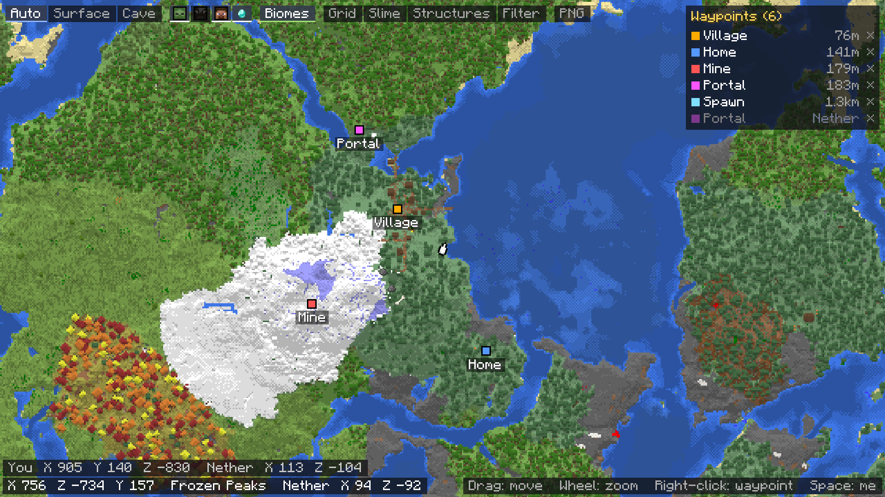
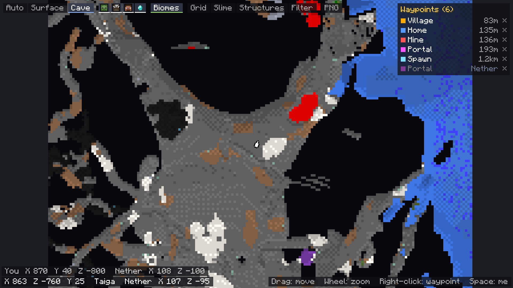
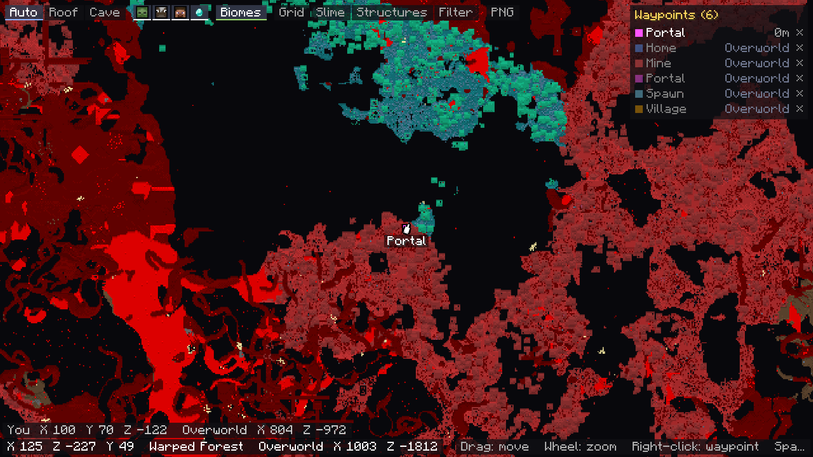
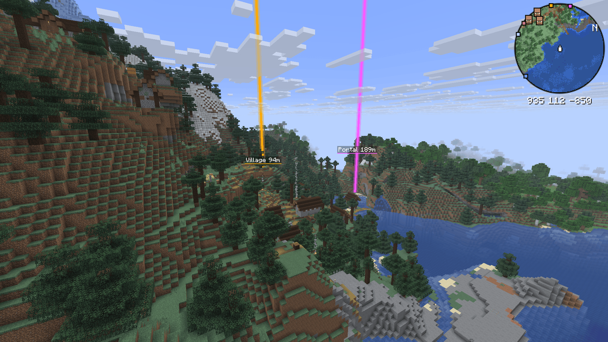

# Atlas

A minimap, world map and waypoints mod for [Horizon](https://github.com/horizon-rust/horizon)
(Minecraft: Java Edition 26.3 in Rust). A WebAssembly `.hmod`: nothing to compile, and it runs in
the game's sandbox.

## Features

- **Minimap**: square or round, north-up or rotating, any corner, adjustable size and zoom.
- **World map** (M): everything you explored, in biome colours. Smooth drag and zoom; the cursor
  shows coordinates, biome and the matching Nether / Overworld position.
- **Layers**: surface, the caves at your height, and the Nether below and above its roof.
- **Radar**: mobs as their faces, plus players and dropped items. Hover one on the map for its name.
- **Waypoints** (J): name, colour, hide, track with a HUD arrow, beams in the world. J puts the
  waypoint on the block you aim at. Linked Nether waypoints, automatic Death / Spawn / Bed
  waypoints, sharing through chat.
- **Explore**: chunk grid, slime chunks and structures. Exact in single player and on a LAN host;
  on other servers, possible positions from a seed you enter.
- **Export** the map as a PNG.

<table>
  <tr>
    <td width="50%"></td>
    <td width="50%"></td>
  </tr>
  <tr>
    <td>World map</td>
    <td>Radar</td>
  </tr>
  <tr>
    <td></td>
    <td></td>
  </tr>
  <tr>
    <td>Cave layer</td>
    <td>Nether</td>
  </tr>
  <tr>
    <td></td>
    <td></td>
  </tr>
  <tr>
    <td>Structures and filter</td>
    <td>J: waypoint on the aimed block</td>
  </tr>
  <tr>
    <td></td>
    <td></td>
  </tr>
  <tr>
    <td>Round, rotating minimap</td>
    <td></td>
  </tr>
</table>

## Install

1. Download `atlas-<version>.hmod` from [Releases](../../releases).
2. Put it in your game folder's `horizon-mods/` (launcher → your instance's ⋮ → Open folder).
3. Add the line `mod.atlas:true` to `horizon-mods.txt` (next to `options.txt`).
4. Restart the game.

Needs Horizon Nightly 2026-11-19 or newer.

## Keys

Rebindable in Options > Controls.

| Key | Does |
|---|---|
| **N** | Minimap on / off |
| **M** | World map |
| **J** | New waypoint on the block you aim at (else where you stand) |

| On the world map | Does |
|---|---|
| Drag / wheel | Move / zoom |
| Right-click | New waypoint |
| Click a marker | Edit it |
| Space | Back to you |
| Esc or M | Close |

In the waypoint bubble: Enter saves, Esc cancels, Tab picks the next colour, Delete deletes.

Settings, files and known limits: [`atlas/README.md`](atlas/README.md).

## Layout

- `atlas/`: the mod (`cargo horizon-mod build --wasm` inside it).
- `atlas-explore/`: a dependency-free library (Java `Random`, slime chunks, structure placement,
  strongholds) used by the Explore layer. `cargo test` inside it.

## Licence

MIT, see [`LICENSE`](LICENSE). By publicusr.
