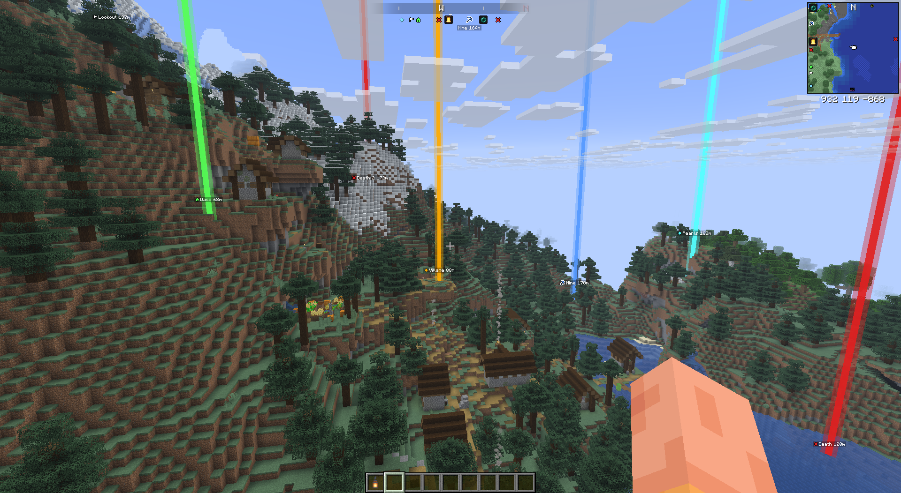
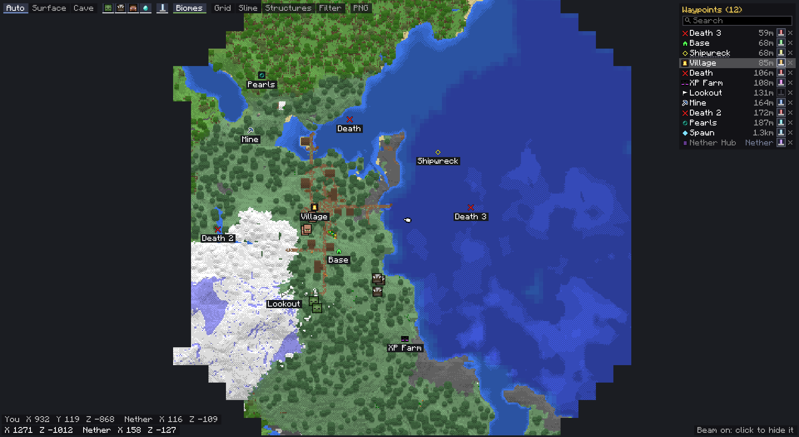
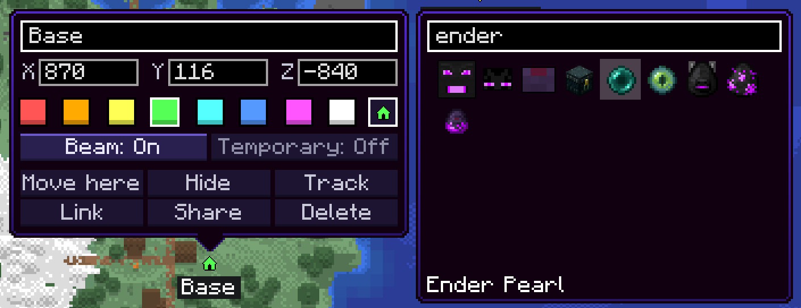
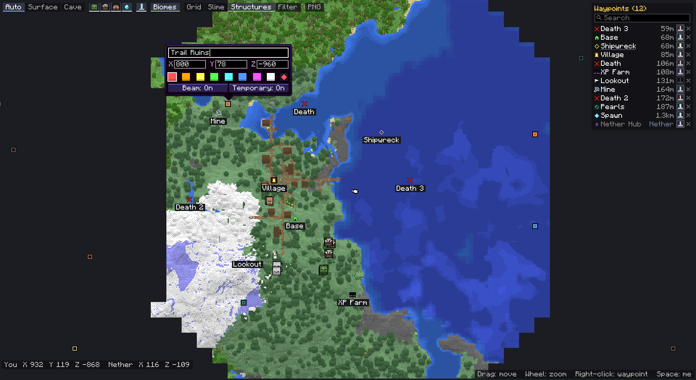
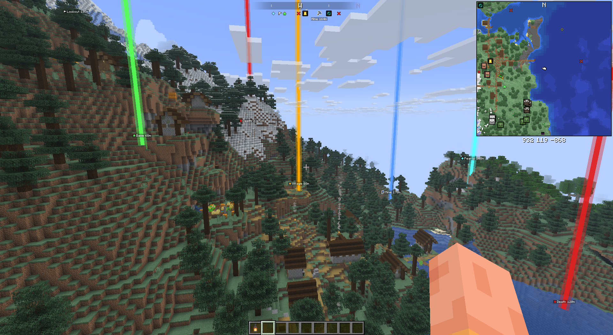
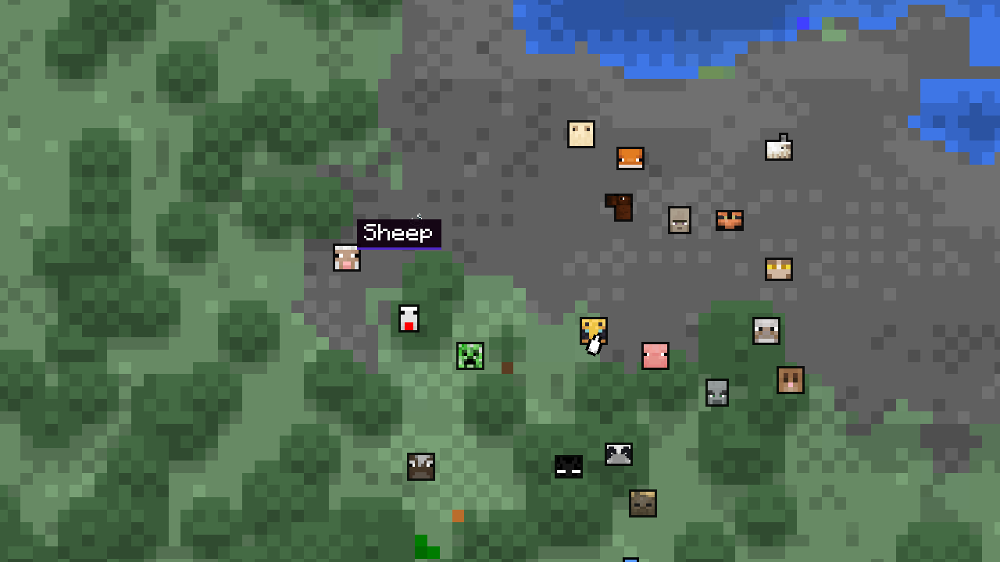
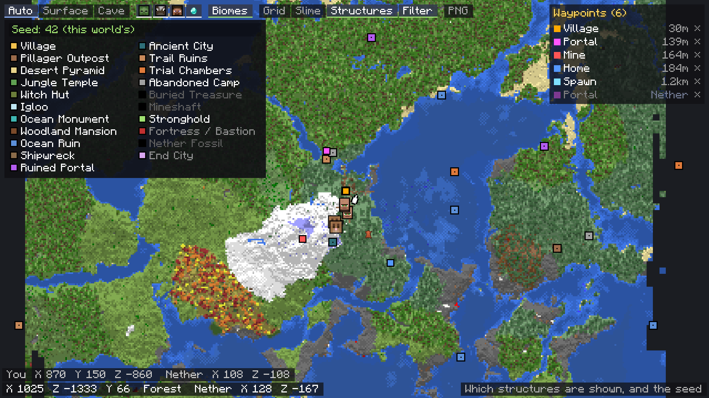
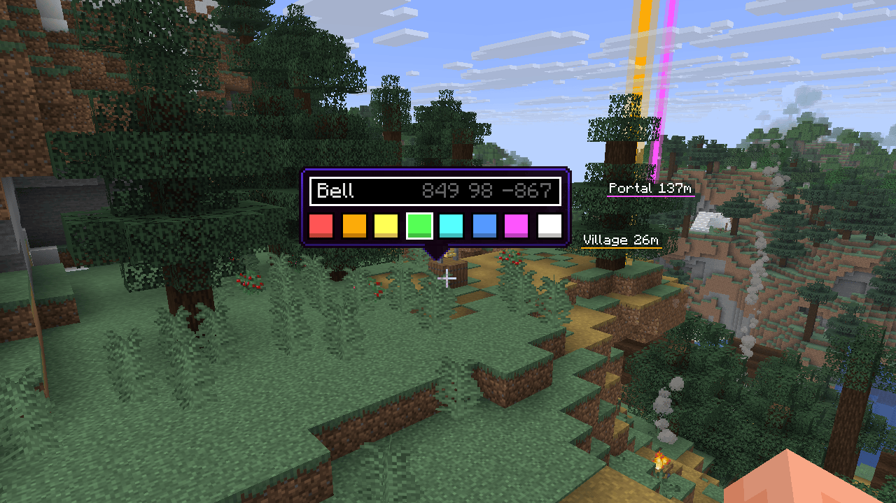

# Atlas

A minimap, world map and waypoints mod for [Horizon](https://github.com/horizon-rust/horizon)
(Minecraft: Java Edition 26.3 in Rust). A WebAssembly `.hmod`: nothing to compile, and it runs in
the game's sandbox.

## Features

- **Minimap**: square or round, north-up or rotating, any corner, adjustable size and zoom.
- **World map** (M): everything you explored, in biome colours. Smooth drag and zoom; the cursor
  shows coordinates, biome and the matching Nether / Overworld position.
- **Layers**: surface, the caves at your height, and the Nether below and above its roof.
- **Radar**: mobs as their faces, plus players and dropped items. Hover one on the map for its name.
- **Waypoints** (J): name, colour, an **icon** (a shape, any item or any mob face), exact X Y Z,
  hide, track, beams in the world. J puts the waypoint on the block you aim at. Per-waypoint
  **beam switch**, beams that fade when you're close, a search box, **temporary waypoints** that
  delete themselves when you arrive (Shift+J, or click a structure on the map), the last 3 deaths,
  automatic Spawn / Bed, linked Nether waypoints, sharing through chat and `/atlas add`.
- **HUD**: quick zoom (`[` / `]`), hold **Z** to enlarge the minimap, an optional **compass bar**
  with your waypoints; the minimap gives way to F3, chat and menus.
- **Explore**: chunk grid, slime chunks and structures. Exact in single player and on a LAN host;
  on other servers, possible positions from a seed you enter.
- **Export** the map as a PNG.

### New in 0.4

<table>
  <tr>
    <td width="50%"></td>
    <td width="50%"></td>
  </tr>
  <tr>
    <td>Waypoint list: search, beam switches, icons</td>
    <td>X Y Z, beam, temporary, and the icon picker</td>
  </tr>
  <tr>
    <td></td>
    <td></td>
  </tr>
  <tr>
    <td>Click a structure: a temporary waypoint there</td>
    <td>Hold Z: bigger minimap</td>
  </tr>
</table>

### Everything else

<table>
  <tr>
    <td width="50%"></td>
    <td width="50%"></td>
  </tr>
  <tr>
    <td>World map</td>
    <td>Radar</td>
  </tr>
  <tr>
    <td></td>
    <td></td>
  </tr>
  <tr>
    <td>Cave layer</td>
    <td>Nether</td>
  </tr>
  <tr>
    <td></td>
    <td></td>
  </tr>
  <tr>
    <td>Structures and filter</td>
    <td>J: waypoint on the aimed block</td>
  </tr>
  <tr>
    <td></td>
    <td></td>
  </tr>
  <tr>
    <td>Round, rotating minimap</td>
    <td></td>
  </tr>
</table>

## Install

1. Download `atlas-<version>.hmod` from [Releases](../../releases).
2. Put it in your game folder's `horizon-mods/` (launcher → your instance's ⋮ → Open folder).
3. Add the line `mod.atlas:true` to `horizon-mods.txt` (next to `options.txt`).
4. Restart the game.

Needs Horizon Nightly 2026-11-20 (0a875da) or newer. Coming from 0.3.x: your map and waypoints
carry over; don't go back to 0.3.x afterwards (it can't read the new icon and flags).

## Keys

Rebindable in Options > Controls.

| Key | Does |
|---|---|
| **N** | Minimap on / off |
| **M** | World map |
| **J** | New waypoint on the block you aim at (else where you stand) |
| **Shift+J** | The same, temporary (deleted when you get there) |
| **[** / **]** | Minimap zoom in / out |
| **Z** (hold) | Bigger minimap |

| On the world map | Does |
|---|---|
| Drag / wheel | Move / zoom |
| Right-click | New waypoint |
| Click a marker | Edit it |
| Space | Back to you |
| Esc or M | Close |

In the waypoint bubble: Enter saves, Esc cancels, Tab moves between the name and X / Y / Z, Delete
deletes. Chat: `/atlas add <name> <x> <y> <z> [dimension]` (`~` = where you are).

Settings, files and known limits: [`atlas/README.md`](atlas/README.md).

## Layout

- `atlas/`: the mod (`cargo horizon-mod build --wasm` inside it).
- `atlas-explore/`: a dependency-free library (Java `Random`, slime chunks, structure placement,
  strongholds) used by the Explore layer. `cargo test` inside it.

## Licence

MIT, see [`LICENSE`](LICENSE). By publicusr.
